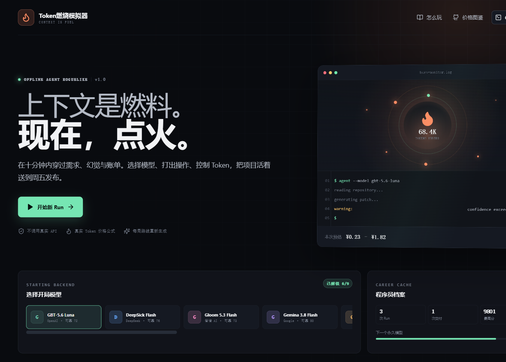

# Token燃烧模拟器

一款在浏览器中运行的轻策略 Agent Roguelike（**v2.0 完整可玩版**）。玩家扮演程序员，先选择工作方式与模型，再在人民币预算、上下文窗口、Deadline 和代码稳定度耗尽前，穿过分支项目、随机事件与上下文休整节点，最终完成“周五 17:59 的发布”。结算后可打开**一局复盘**，看清费用、纪律与风险。

游戏完全采用预设内容，不调用任何真实大模型 API，不要求 API Key，也不会产生真实费用。Token 用量和费用使用现实模型公开价格的快照进行离线模拟。



## 可玩入口

- 仓库根目录执行：`npm install && npm run play`
- Windows 可双击 `start-game.cmd`
- 生产构建在 `dist/`（静态托管 / GitHub Pages 可直接部署）

对局建议桌面浏览器 **1280px+**；移动端可浏览主页，对局布局以桌面为准。

## 启动

要求：Node.js 20 或更高版本。

```powershell
cd token-run
npm install
npm run play
```

浏览器会打开本地地址。也可以使用 `npm run dev` 启动开发模式，或使用 `npm run build` 生成生产构建。

## 核心玩法

- 开局先选**工作方式（流派）**与模型：省钱 / 证据 / 重写 / 压缩，各自有被动与偏好卡池。
- 一局约 10 分钟，共七层路线；前三个项目三选一，中间出现二选一分支，最终汇聚到发布 Boss。
- 项目通过调查、实现、验证三条进度推进；卡牌有明确前置证据，先改后查会增加 Token 返工、稳定度损失和“流程债务”，按顺序执行则会积累小额连击加成。
- 操作执行前只显示模糊 Token、费用和风险预测，执行后才显示输入、缓存、输出 Token 及人民币费用。
- Agent 的自信语气不是证据：代码 Diff、测试终端和风险调查才会提高交付把握。
- 每次项目成功后，从新模型或运行时 Buff 中选择一项。
- 结算可进入**复盘页**：分数五段、项目时间线、纪律统计与风险标签。
- Run 失败后，可以沿同一随机种子从第一层重试一次；此后重新生成路线。
- 职业 XP、起始模型解锁、图鉴和最高分使用 `localStorage` 保存在浏览器本地。

## v2.0 内容

- **20** 个项目（含 Boss），覆盖竞态、泄漏、时区、注入、依赖升级、缓存击穿等。
- **18** 张操作卡：在原有调查/实现/验证/控制闭环上，增加类型检查、结对调试、提取重构、故障重放、RFC、范围冻结。
- **10** 个随机事件与 3 种上下文休整决策。
- **12** 个现实模型价格映射、**10** 种运行时 Buff、**4** 条流派。
- 复盘审计时间线、结算分段动画、流派角标与错序债务反馈。
- Codax Workbench 与 Cloude Code Terminal 两种 Agent 外壳；完整浅色/深色主题。
- 可选程序化背景音乐与操作音效；Web Audio 离线生成。

### 四条流派

| 流派 | 一句话 | 被动取向 |
| --- | --- | --- |
| 省钱流 | 账单比代码更可怕 | 调用费用打折，上下文略贵 |
| 证据流 | 先留证据，再谈交付 | 连击纪律加分更高，调查/验证更强 |
| 重写流 | 修什么修，整段换掉 | 实现进度更高，重写稳定度惩罚更低 |
| 压缩流 | 上下文是燃料 | 操作占上下文更少，压缩少丢调查 |

## 价格口径

价格快照日期为 **2026-09-10**。人民币厂商直接使用人民币公开价格；美元价格按游戏参考汇率 `1 USD ≈ ¥7.15` 换算。

游戏使用百万级操作量：一次扫描约 2.4M–5.8M 输入 Token，重写约 14M–34M 输入 Token；完整一局的累计用量通常会进入数十到数百 M Token。预算是为了可玩性放大的离线游戏额度，价格公式仍保持每百万 Token 的现实计价口径。

每次操作采用以下公式：

```text
费用 = 未缓存输入 Token × 输入费率
     + 缓存命中 Token × 缓存费率
     + 输出 Token × 输出费率
     （再应用流派费用倍率与 Buff 折扣）
```

模型费率和官方来源集中维护在 `src/game/data.ts`。游戏内“价格图鉴”也可以直接打开每个厂商的官方来源页。价格会变化，本项目的历史快照不能替代真实账单。

## 终局分数

一局的总分由五部分相加：

```text
总分 = 行动得分
     + 已交付项目 × 300 − 失败交付 × 180
     + 流程纪律（按序 +1 / 错序 −1，逐点 25 分，计入区间 −12…+24；证据流连击可 +2）
     + 剩余资源（预算 × 0.28 + 剩余 Deadline × 42 + 稳定度 × 16）
     + 周五行交付奖励 400
```

剩余预算只是其中一项。按顺序留证据、减少返工和被打回，同样能明显拉开分数。

## 验证

```powershell
npm run lint
npm test
npm run build
```

CI（`.github/workflows/ci.yml`）会依次执行这三条命令。

当前自动测试覆盖固定种子路线、百万级 Token 与费用结算、模型能力差异、上下文压缩、卡牌冷却、操作顺序惩罚、模型切换、交付置信度、休整节点、价格数据、职业解锁、**流派被动与手牌权重**、**内容池体量**，以及休整节点的上下文溢出保护、四类失败条件、终局计分构成、日志 id 确定性、手牌稳定性与旧存档迁移。

`npm run build` 会重新生成 `dist/`。本项目把 `dist/` 纳入版本库用于静态托管，因此改完源码后需要重新构建并一并提交，否则线上仍是旧包。

## 说明

Codax、Cloude、DeepSick、Gemina、Gloom、Qwan 与 GBT 均为戏仿名称。本项目与 OpenAI、Anthropic、Google、DeepSeek、智谱 AI、阿里云等现实厂商不存在隶属、赞助或背书关系。

完整设计记录见 [docs/GAME_DESIGN.md](docs/GAME_DESIGN.md)。
